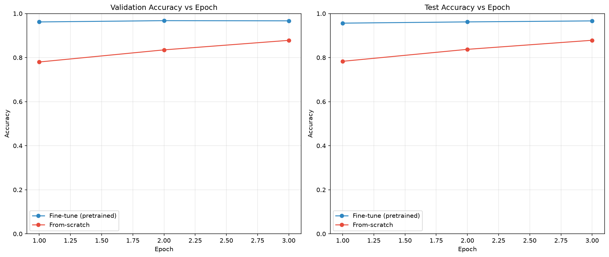
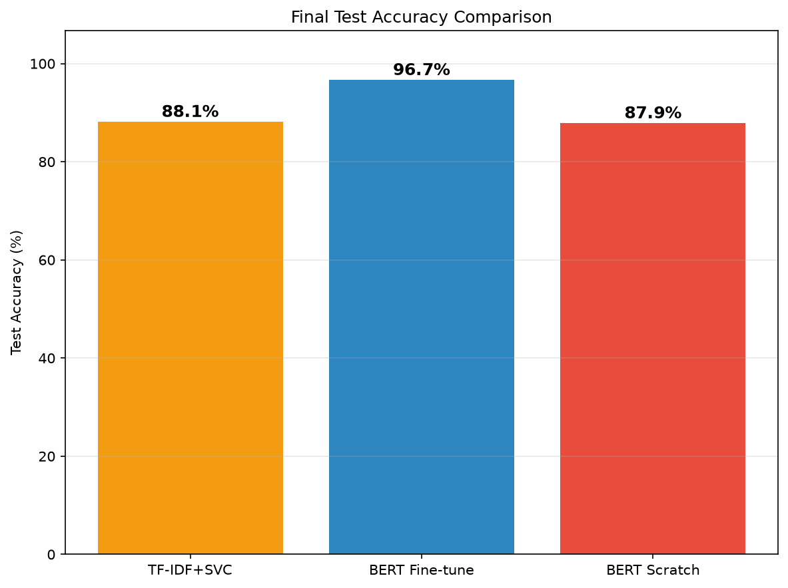

# BERT 中文文本分类实验 (bert-thucnews-classification)

中文文本分类（Text-line 第 1 步）：在 THUCNews 10 分类数据集上，对比 **BERT-base-chinese 微调**、**BERT 从头训练** 与 **TF-IDF + LinearSVC 传统基线** 三种方案。




## 实验结果

| 方案 | 测试准确率 |
|------|-----------|
| TF-IDF + LinearSVC | 88.13% |
| BERT-base-chinese 微调 | **96.65%** |
| BERT-base-chinese 从头训练 | 87.86% |

- 数据集：THUCNews 10 类（train 50000 / val 5000 / test 9890），全量文章
- BERT 微调：3 epoch, lr 2e-5, batch 32, max_len 128
- BERT 从头：3 epoch, lr 2e-4（随机初始化）
- TF-IDF：max_features 50000, ngram 1-2, sublinear_tf, LinearSVC C=1.0

## 关键结论

1. **预训练优势**：微调 96.65% vs 从头 87.86%（+8.8pp），预训练权重带来显著迁移收益。
2. **从头训练已可用**：87.86% 说明 BERT 架构本身在文本分类上收敛较快，但仍落后微调。
3. **传统基线强**：TF-IDF+SVC 88.13% 几乎追平从头训练，词袋特征在中文分类上依然有效。
4. **收敛极快**：微调第 1 个 epoch 即达 95.63%，预训练特征高度可迁移。

## 环境与复现

```bash
pip install -r requirements.txt
python download_data.py        # 下载 THUCNews arrow 文件到 data/
python code/train_bert.py --device cuda --epochs 3 --batch 32   # 完整训练
python code/plot_bert.py       # 生成图表
```

> **注意**：BERT-base-chinese 权重需从 hf-mirror.com 下载到本地 `hf_cache/bert-base-chinese/`（config.json, vocab.txt, tokenizer_config.json, pytorch_model.bin），`train_bert.py` 默认从该本地路径加载，避免 HuggingFace Hub 直连超时。

## 数据集说明

- 来源：[seamew/THUCNewsText](https://huggingface.co/datasets/seamew/THUCNewsText)（Arrow stream 文件）
- 类别（10 类）：education, entertainment, fashion, finance, game, politic, society, sport, stock, technology
- 标签映射：0=education, 1=entertainment, 2=fashion, 3=finance, 4=game, 5=politic, 6=society, 7=sport, 8=stock, 9=technology
- 使用 `pyarrow.ipc.open_stream` 读取（Arrow STREAM 格式，非 File 格式）

## 目录结构

```
bert-thucnews-classification/
├── README.md
├── requirements.txt
├── download_data.py
├── .gitignore
├── LICENSE
├── code/
│   ├── train_bert.py        # 主训练脚本（TF-IDF / BERT 微调 / BERT 从头）
│   └── plot_bert.py         # 图表生成
├── figures/
│   ├── learning_curve.png
│   └── accuracy_bar.png
├── results/
│   └── result_summary.json
└── docs/
    ├── 00_README_总览.md
    ├── 01_方案说明.md
    ├── 02_环境搭建.md
    ├── 03_操作步骤.md
    ├── 04_实验报告.md
    └── 06_代码说明.md
```

## License

MIT